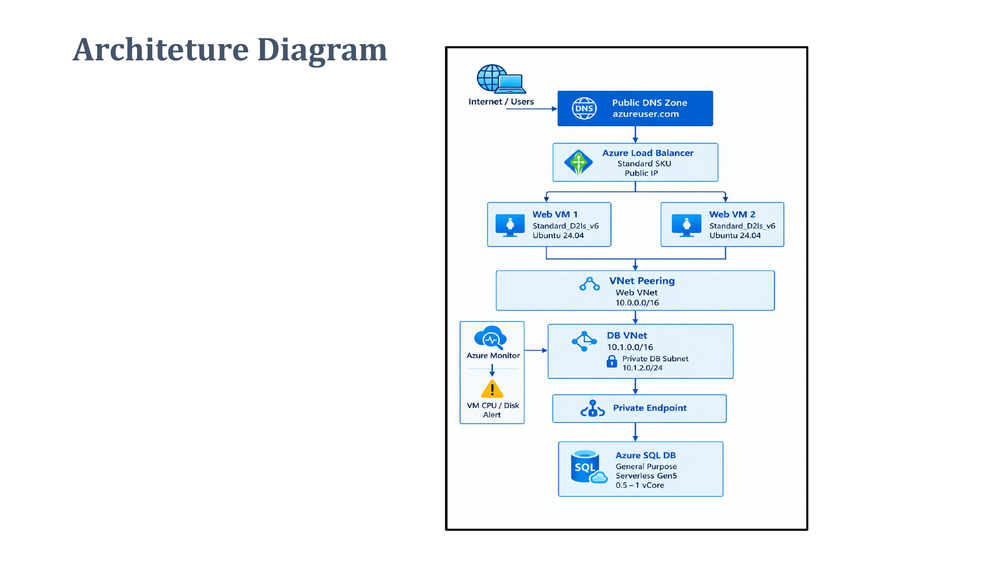

# Highly Available Web Application Architecture on Microsoft Azure

## Project Overview
Designed a highly available web application architecture using Microsoft Azure services.

The architecture uses two Linux Virtual Machines behind an Azure Standard Load Balancer to distribute incoming traffic and improve application availability.

Azure SQL Database is connected through a Private Endpoint to provide secure database connectivity.

## Technologies Used
- Microsoft Azure
- Azure Virtual Network (VNet)
- Azure Standard Load Balancer
- Linux Virtual Machines (Ubuntu 24.04)
- Azure SQL Database
- Azure Private Endpoint
- Azure Private DNS Zone
- VNet Peering
- Azure DNS
- Azure Monitor
- Network Security Groups (NSG)

## Architecture Diagram

## Project Implementation

### 1. Networking
- Created separate Web VNet and Database VNet.
- Configured VNet Peering.
- Configured Network Security Groups.

### 2. Web Server Layer
- Configured two Linux Virtual Machines.
- Used Ubuntu 24.04.
- Connected both VMs to the Load Balancer backend pool.

### 3. Load Balancer and DNS
- Configured Azure Standard Load Balancer.
- Configured health probes.
- Configured DNS A record pointing to the Load Balancer public IP.

### 4. Database and Security
- Configured Azure SQL Database.
- Configured Private Endpoint.
- Configured Private DNS Zone.
- Restricted direct public database access.

### 5. Monitoring
- Used Azure Monitor to monitor VM performance and available memory.

## Key Features
- High availability using two web servers.
- Traffic distribution using Load Balancer.
- Secure private database connectivity.
- Network isolation using separate VNets.
- DNS-based application access.
- Infrastructure monitoring.

## Architecture Workflow
1. Users access the application through DNS.
2. Azure DNS resolves the domain to the Load Balancer public IP.
3. Load Balancer distributes traffic between two Linux VMs.
4. Web VMs connect to Azure SQL Database through Private Endpoint.
5. Azure Monitor tracks infrastructure performance.

## Project Status
This project was previously deployed as a hands-on Azure learning project. The Azure resources have since been deleted. This repository contains the architecture diagram and project documentation.

## Author
Ganesha N S

GitHub: https://github.com/ganeshns935-max
